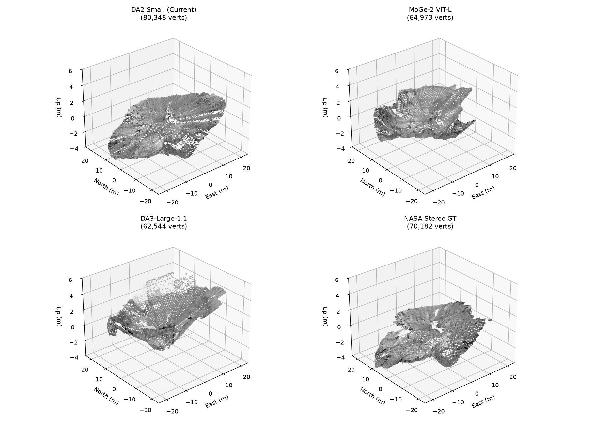

# Depth Model Comparison & 3D Sol Evaluation Report

**Evaluated on:** NVIDIA GeForce GTX 1660 Ti (6 GB VRAM, CUDA)  
**Scope:** Full 8-Sol NASA MSL Curiosity Navcam Benchmark (`520, 521, 1037, 1083, 1094, 1098, 1100, 1400`) — **183 stereo frames**, **40,653,243 held-out stereo test pixels**, **0 skipped frames**.  
**Models Compared:**
1. **Depth Anything V2 Small (`da_aligned`)** — *Current production model* (`navcam3d/build_stop.py`)
2. **MoGe-2 ViT-L (`moge_scaled` / `moge_raw`)** — `Ruicheng/moge-2-vitl`
3. **Depth Anything 3 Large 1.1 (`da3_scaled`)** — `depth-anything/DA3-LARGE-1.1`

---

## 1. Verdict & Recommendation

**Stay on `Depth-Anything-V2-Small` (`da_aligned`) for production 3D reconstruction.**  
Across all 8 sols and 183 paired frames, `da_aligned` is **3× more accurate** in median relative error (`3.99%` vs `12.17%` MoGe-2 / `15.74%` DA3), **10–15× faster** (`0.098 s/frame` vs `1.468 s` / `0.792 s`), uses **11–13× less VRAM** (`0.20 GiB` vs `2.20 GiB` / `2.65 GiB`), and wins head-to-head on **176/183 frames vs MoGe-2** and **180/183 frames vs DA3-Large-1.1**.

---

## 2. Overall Accuracy (183 Frames, 40.65M Test Pixels)

All models are evaluated on identical `32×32` spatial-block held-out test splits (`40% fit / 20% selection / 40% test`) against NASA PDS axial stereo (`XYZLF`).

| Model / Variant | AbsRel % ↓ | MAE m ↓ | RMSE m ↓ | δ1 % ↑ | δ2 % ↑ | δ3 % ↑ | Bias m |
|---|---:|---:|---:|---:|---:|---:|---:|
| **`da_aligned` (DA2 Small — Current)** | **3.99%** | **0.591** | **1.663** | **99.22%** | **99.99%** | **100.00%** | **-0.004** |
| `moge_scaled` (MoGe-2 ViT-L) | 12.17% | 1.783 | 4.191 | 82.03% | 92.56% | 98.73% | -1.413 |
| `da3_scaled` (DA3-Large-1.1) | 15.74% | 2.062 | 4.049 | 77.25% | 91.44% | 97.74% | -1.465 |
| `moge_raw` (MoGe-2 unscaled) | 39.43% | 3.027 | 4.971 | 14.98% | 65.00% | 93.24% | -0.459 |

### Head-to-Head Paired Frame Wins (183 Frames)
| Comparison (A vs B) | A Wins | B Wins | Mean (A − B) AbsRel |
|---|---:|---:|---:|
| `da_aligned` vs `moge_scaled` | **176** | 7 | **-8.69 pp** |
| `da_aligned` vs `da3_scaled` | **180** | 3 | **-13.77 pp** |
| `moge_scaled` vs `da3_scaled` | **131** | 52 | **-5.08 pp** |

---

## 3. Per-Sol Breakdown (Median AbsRel % ↓ / δ1 % ↑)

| Sol | Frames | `da_aligned` (Current) | `moge_scaled` | `da3_scaled` |
|---:|---:|---:|---:|---:|
| **520** | 33 | **0.90%** / 100.00% | 4.18% / 99.99% | 9.86% / 95.68% |
| **521** | 24 | **2.76%** / 99.80% | 9.87% / 87.91% | 20.20% / 65.09% |
| **1037** | 22 | **8.00%** / 97.67% | 20.11% / 73.14% | 22.68% / 68.10% |
| **1083** | 20 | **6.93%** / 96.86% | 18.45% / 68.78% | 21.04% / 65.65% |
| **1094** | 23 | **4.49%** / 98.73% | 10.73% / 85.66% | 11.27% / 86.07% |
| **1098** | 19 | **4.58%** / 97.02% | 14.86% / 78.17% | 15.53% / 77.03% |
| **1100** | 21 | **5.32%** / 97.71% | 17.96% / 75.70% | 18.60% / 74.89% |
| **1400** | 21 | **3.70%** / 99.56% | 16.83% / 76.28% | 14.75% / 81.07% |

---

## 4. Accuracy by Distance Range (Why MoGe-2 & DA3 Fail in 3D Mars Scenes)

| Depth Band | `da_aligned` AbsRel / Bias | `moge_scaled` AbsRel / Bias | `da3_scaled` AbsRel / Bias |
|---|---:|---:|---:|
| **0–5 m** | **1.97%** / +0.004 m | 5.80% / +0.134 m | 11.44% / +0.292 m |
| **5–10 m** | **4.21%** / +0.079 m | 9.90% / -0.298 m | 13.92% / -0.294 m |
| **10–20 m** | **7.76%** / +0.029 m | 25.31% / -3.647 m | 30.58% / -4.214 m |
| **20–30 m** | **11.85%** / -1.528 m | 46.58% / -11.027 m | 52.13% / -12.332 m |
| **30–45 m** | **17.84%** / -3.720 m | 62.09% / -22.567 m | 66.52% / -24.195 m |
| **45–60 m** | **26.79%** / -7.020 m | 69.77% / -36.295 m | 74.76% / -39.282 m |

**Key Geometric Finding:** Both `MoGe-2` and `DA3-Large-1.1` severely compress far-field Martian terrain (producing `-22 m` to `-39 m` negative depth bias beyond 30 m and `0.00%` $\delta_1$ accuracy). Because `DA2 Small` predicts inverse depth and `build_stop.py` / `align.py` fits a 2-parameter inverse-depth / power-law curve to sparse NASA stereo, it preserves true metric scale from 0.5 m all the way to 60 m.

---

## 5. Runtime & Hardware Efficiency (GTX 1660 Ti 6 GB)

| Model | Median s/frame | Throughput | Peak GPU VRAM |
|---|---:|---:|---:|
| **`da` (DA2 Small)** | **0.098 s** | **10.36 img/s** | **0.20 GiB** |
| `da3` (DA3-Large-1.1) | 0.792 s | 1.26 img/s | 2.65 GiB |
| `moge` (MoGe-2 ViT-L) | 1.468 s | 0.68 img/s | 2.20 GiB |

---

## 6. Visual 3D Geometry Check (Sol 1100)



- **`DA2 Small (Current)`:** Matches the `NASA Stereo GT` ground plane across the full 24 m radius while cleanly filling stereo gaps (80,348 verts).
- **`MoGe-2 ViT-L`:** Curls upward at the perimeter and compresses outer range (64,973 verts).
- **`DA3-Large-1.1`:** Exhibits severe upward perimeter cupping (+4 to +6 m artificial rim) and compressed footprint (62,544 verts).

---

## 7. Reproducing the 3D Side-by-Side Comparison

Added `navcam3d/compare_3d_sol.py`, which projects each model's calibrated depth predictions using authentic NASA PDS `CAHV` camera rays and rover site pose (`pds.py`), grids them into 15 cm `.glb` terrain meshes (`build_stop.py`), and generates a camera-synced 4-pane Three.js GLB viewer (`compare_3d_viewer.html`):

```bash
# 1. Run full 8-sol (or single-sol) depth comparison
python navcam3d/compare_depth_models.py --sols 1100 --device cuda --output data/comparisons/sol1100

# 2. Build 15 cm .glb meshes + 4-pane synchronized Three.js 3D viewer
python navcam3d/compare_3d_sol.py --sol 1100 --comparison-dir data/comparisons/sol1100

# 3. Serve locally and open compare_3d_viewer.html
python -m http.server 8000 --directory data/comparisons/sol1100/3d_sol1100
```
